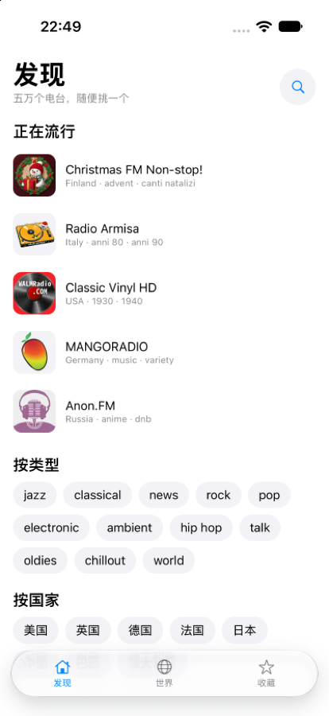
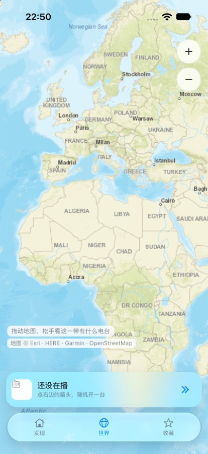
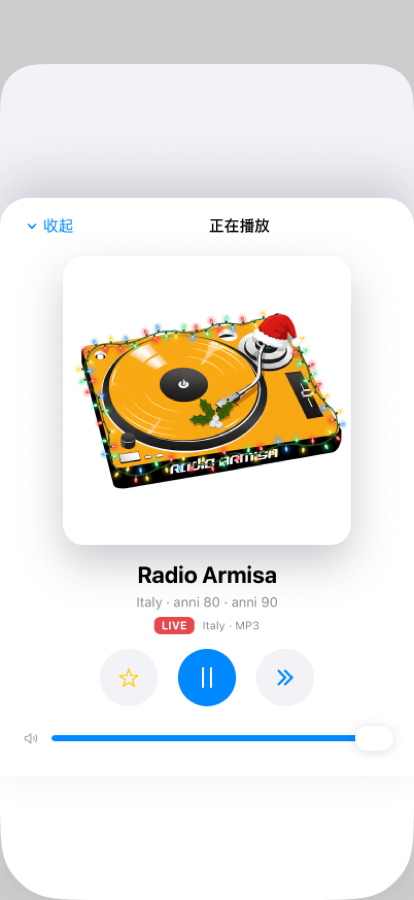

# Airwave — 用 Exact + radio-browser 做的三端网络电台

一份 Contract 同时出 **Web / iOS / macOS**，数据来自 [radio-browser.info](https://www.radio-browser.info/)（5.2 万个公开电台）。只播 https 流。

## 截图（iOS）

<table>
  <tr>
    <td align="center"><br><sub>发现 · 正在流行 / 分类</sub></td>
    <td align="center"><br><sub>世界 · 拖动地图选电台</sub></td>
    <td align="center"><br><sub>正在播放 · sheet</sub></td>
  </tr>
</table>

在线版：**https://airwave-76y.pages.dev**（Web / iOS / macOS 同一份 Contract）

## 目录

| 路径 | 内容 |
| --- | --- |
| [airwave/](airwave/) | 应用本体：`app.contract`（视图）、`app.ts`（数据模块）、`app.json`（清单）、`app.test.contract`（交互测试） |
| [docs/01-research-exact.md](docs/01-research-exact.md) | Exact 框架深度调研：渲染模型、Contract 语言、音频/媒体会话/后台播放、网络与 ATS 限制、与 RN/Flutter/Tauri 的对比 |
| [docs/02-research-radio-browser.md](docs/02-research-radio-browser.md) | radio-browser API 实测：规模、端点、字段、数据质量（2000 条样本统计）、性能、许可与礼节、没有的东西 |
| [docs/03-plan.md](docs/03-plan.md) | **实现计划**：产品范围、架构、数据层、持久化、播放器状态机、跨平台差异矩阵、P0–P3 里程碑与验收、风险、决策记录 |
| [docs/04-build-log.md](docs/04-build-log.md) | 实现记录：Contract 语法踩坑、工具链补丁、三端布局经验、验证方式 |
| [docs/05-ui-redesign.md](docs/05-ui-redesign.md) | **UI/UX 重构**：同类 app 调研（Sonos / TuneIn / iHeartRadio / Radio Garden / iOS 26 Liquid Glass）、新信息架构、首页与播放面板规格、设计令牌、与第一版的对照 |
| [docs/06-hig-review.md](docs/06-hig-review.md) | **Liquid Glass / HIG 复核**：按 apple-design-skill 的五镜流程逐条对照，列出已修（浮动玻璃栏、regular 材质的迷你条、44×44 触控目标）与待办（面板改 sheet、辅助功能设置复核、macOS 快捷键） |

原始调研材料（下载的 Exact 文档、样本数据）在 `.research/`；Exact SDK 在 `.extern/exact`；工具链在 `.tools/`（`source .tools/env.sh` 后用 `bun`）。

## 跑起来

```sh
source .tools/env.sh
cd airwave
bun exact.mjs web          # 浏览器开发循环
bun exact.mjs test web     # 交互测试
bun exact.mjs mac --run    # macOS 原生
bun exact.mjs ios --run    # iOS 模拟器
```

## 现在到哪一步

四端都能跑：Web（`bun exact.mjs web-build --out dist`，12 个交互测试通过，已部署到 Cloudflare Pages）、macOS（`Airwave.app`）、iOS 模拟器、Android（真机已装）。UI 按 [docs/05-ui-redesign.md](docs/05-ui-redesign.md) 重做、并按 [docs/06-hig-review.md](docs/06-hig-review.md) 补上 Liquid Glass：三个 tab（**发现 / 世界 / 收藏**）+ 推入式搜索页（语言/编码筛选）+ 推入路由（热门榜 `/popular`、类型与国家）；世界页是 **可拖动、可双指缩放的地图**（松手就列这一带最近的电台，点行才播并飞过去）；播放面板是从底部起的 **sheet 路由**（可下拉、点面板外收起），里面是大封面 + LIVE + 三键 + 音量。已实现：分页加载（每页 40 条，滚到底自动续）、语言/编码筛选、**播放失败先用备用 `url` 重试、再自动连跳 2 台**（`.m3u8/.m3u/.pls` 直接过滤，错误按 network/decode/not-allowed 分文案；「换一台」按当前列表顺序换下一台）、静音记忆（恢复到静音前的音量）、列表骨架屏与首屏缓存（会话内 LRU，切 tab 秒回）、搜索历史、收藏与最近收听（`app:/data` JSON）、Media Session（锁屏与控制中心）、1024px 应用图标。截图在 `.research/shots/`。

未做（P2 之后）：HLS 流的自研播放（现在只做过滤与提示）、播放列表文件（`.m3u`/`.pls`）的解析、商店截图素材、iOS 真机签名（`DEVELOPMENT_TEAM`）与 Mac 公证（`bun exact.mjs release`）。

## 三句话结论

1. **功能可行**：Exact 的 `audio` 元素 + Media Session + iOS `audio_session: playback` 覆盖了"长音频流 + 后台 + 锁屏 + 媒体键"，这正是电台 App 的全部核心。
2. **后端可省**：radio-browser 的 CORS 全开，浏览器与原生都能直连；热门榜 3000 条只有 3.4 MB，可以随包做种子数据。
3. **风险在平台差异与框架成熟度**：只播 https 后约 64.7% 的台可用（http 台不展示），HLS 台在 Web 上播不了；Exact 是 pre-1.0 且无三方 SDK 生态，所以先做 P0 技术验证再铺功能。
